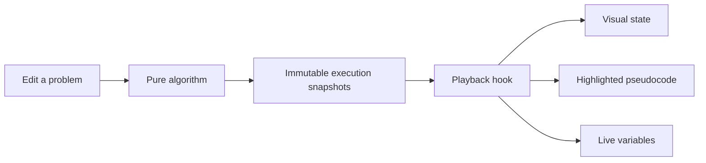

<div align="center">


**A visual workspace for algorithms, engineering concepts, system design, Spring, and LLMs.**

150 lessons · 13 libraries · 40 algorithms · 37 systems labs · 11 Spring lessons · 12 LLM lessons

[Live demo ↗](https://algo.kartikey.cv) · [Start locally](#-start-in-two-commands) · [Explore the lessons](#-the-playground) · [Study path](#-a-path-through-the-patterns) · [Architecture](#-built-to-grow)

</div>

---

## ✦ Learn the decision, not just the answer

What happens when a binary-search target is missing? Why does a greedy coin choice fail? When does a cheap flight use too many stops?

Algorithm Studio makes those questions visible. Edit the problem, step through the actual algorithm, and connect every highlighted line to the state it changes.

| Make it yours                                                          | Watch it happen                                                   | Explain it back                                                                           |
| :--------------------------------------------------------------------- | :---------------------------------------------------------------- | :---------------------------------------------------------------------------------------- |
| Change arrays, targets, capacities, terrain, edges, or flight budgets. | Follow pointers, queues, stacks, recursion, heaps, and DP tables. | Use the invariant, pattern cues, and common pitfalls to explain _why_ an algorithm works. |

Algorithm lessons include an interactive playground, an explanation, and pseudocode. Playback supports **step, back, play/pause, restart, finish, and speed control**. Algorithm execution snapshots come from the solvers themselves. Concept labs use interactive scenarios and controls; design patterns use step-by-step diagrams and pseudocode.

## 🚀 Start in two commands

**Prerequisite:** Node.js 22.12+; Node 24 recommended.

```bash
npm ci
npm run dev
```

Open **[localhost:5173](http://127.0.0.1:5173)**. No API keys, account setup, or database required.

<details>
<summary><strong>Run the production build locally</strong></summary>

Stop the development server first, then:

```bash
npm run build
npm start
```

Both server commands bind to `127.0.0.1`. Vinext builds client and server bundles into `dist/`; the output requires the production server and is not a standalone static site.

</details>

## ☁️ Deploy on every main update

The [Cloudflare deployment workflow](.github/workflows/deploy-cloudflare.yml) tests, builds, and deploys to Cloudflare Workers on every push to `main`. It also supports manual runs on `main`.

Add the repository Actions secrets **`CLOUDFLARE_API_TOKEN`**, **`CLOUDFLARE_ACCOUNT_ID`**, and **`CLOUDFLARE_DOMAIN`**. The domain must be a hostname in an active Cloudflare zone, such as `learn.example.com`. Credentials and the domain stay out of tracked configuration.

See the [deployment setup guide](docs/cloudflare-deployment.md) for token permissions, custom-domain setup, and local Workers validation.

## 🧭 The playground

Choose from 13 focused libraries using a compact sidebar selector: **Algorithms**, **Concepts**, **Design Patterns**, **Case Studies**, **Spring**, **LLM**, **Database Internals**, **Java & JVM**, **Operating Systems**, **Networking & Web Security**, **Distributed Systems Internals**, **Developer Tooling**, and **Practice**. Each has collapsible topics and its own saved scroll position. Global search finds lessons across every library, and a persistent current-lesson shortcut takes you back to what you were studying. Dark and light themes include matching scrollbars.

### Inside the systems you use

These 37 labs make infrastructure decisions visible. Edit the inputs, run a contrasting scenario, inspect the state, and follow highlighted pseudocode. Every lesson includes its assumptions and a primary reference.

| Library                                                                         | Experiments                                                                                                                                 |
| :------------------------------------------------------------------------------ | :------------------------------------------------------------------------------------------------------------------------------------------ |
| **[Database Internals](https://algo.kartikey.cv/lessons/db-bplus)**             | B+ tree splits and lookup, composite indexes, nested-loop versus hash joins, query costs, MVCC snapshots, WAL recovery.                     |
| **[Java & JVM](https://algo.kartikey.cv/lessons/jvm-gc)**                       | Class loading, stack frames and heap references, tracing GC, HashMap collisions and resizing, bounded thread pools, virtual-thread I/O.     |
| **[Operating Systems](https://algo.kartikey.cv/lessons/os-scheduling)**         | Processes versus threads, FCFS and round-robin scheduling, context-switch overhead, FIFO/LRU paging, TLB translations, deadlock prevention. |
| **[Networking & Web Security](https://algo.kartikey.cv/lessons/web-tcp)**       | TCP loss and cumulative ACKs, congestion windows, HTTP cache revalidation, sessions, OAuth/OIDC with PKCE, CORS, CSRF.                      |
| **[Distributed Systems Internals](https://algo.kartikey.cv/lessons/dist-raft)** | Raft replication, leader election, quorum intersections, consistent hashing, vector clocks, Bloom-filter false positives.                   |
| **[Developer Tooling](https://algo.kartikey.cv/lessons/tool-compiler)**         | Git references, three-way merges, rebasing, dependency constraints, expression compilation, CI gates and deployment rollback.               |

The numeric labs compute real results within their stated bounds. Protocol and framework flows model selected scenarios rather than running a real JVM, database, network, or deployment. Query costs, congestion control, dependency resolution, and GC are intentionally simplified; the lesson boundary explains what each model leaves out.

### More Spring and LLM experiments

- **Spring:** [JPA and N+1 queries](https://algo.kartikey.cv/lessons/spring-orm), REQUIRED versus REQUIRES_NEW with connection-pool pressure, and unit/MVC-slice/integration coverage.
- **LLM mechanics:** [learn BPE merges](https://algo.kartikey.cv/lessons/llm-bpe), compare two attention heads, and verify incremental KV caching against a full forward pass.
- **LLM applications:** [retrieval with evidence](https://algo.kartikey.cv/lessons/llm-rag), exact versus clustered vector search, 4/8-bit quantization error, and evaluation that separates token overlap from factual support.

RAG uses a small fictional policy corpus and extractive answers. Vector search uses inspectable two-dimensional vectors. The two-head lab is an illustrative variation of the miniature decoder, not its trained checkpoint. No lesson calls a hosted LLM or requires credentials.

### Active practice

- **Predict before revealing:** choose the next event in a narrated trace before advancing. Regular playback remains available when prediction mode is off.
- **[Compare approaches](https://algo.kartikey.cv/lessons/compare):** step a linear scan and binary search together; compare actual value comparisons and modeled auxiliary variables on the same sorted input.
- **[Find the bug](https://algo.kartikey.cv/lessons/debug):** repair an inclusive search boundary and run failing/passing cases.
- **[My study roadmap](https://algo.kartikey.cv/lessons/roadmap):** suggested prerequisites, bookmarks, confidence, a weak-topic review list, and manually tracked solved LeetCode questions. Progress is stored in this browser.
- **Share traces:** the 24 named-input interview lessons eight new algorithm labs, and all 47 systems and framework extensions can copy a URL containing validated inputs and the current execution step. Input values are visible to anyone with the link.

### Spring, from startup to response

| Lesson                                                                         | Follow the flow                                                                                                                                                                      |
| :----------------------------------------------------------------------------- | :----------------------------------------------------------------------------------------------------------------------------------------------------------------------------------- |
| **[How Spring Boot starts](https://algo.kartikey.cv/lessons/spring-boot)**     | Environment → context → definitions → bean initialization → web server → runners → readiness; conditional auto-configuration.                                                        |
| **Beans & dependency injection**                                               | Construction, dependency resolution, lifecycle callbacks, and post-processing/proxies.                                                                                               |
| **[HTTP request → response](https://algo.kartikey.cv/lessons/spring-request)** | Servlet filters → security → DispatcherServlet → argument conversion/validation → controller → transactional service → repository/DB → JSON serialization → filter cleanup → client. |
| **Security filter flow**                                                       | Authentication, authorization, chain selection, and an API rejection before controller invocation.                                                                                   |
| **Transactions & proxy boundaries**                                            | Commit, rollback, and self-invocation bypassing proxy advice.                                                                                                                        |
| **Async, scheduling & events**                                                 | Executor handoff, caller/worker separation, synchronous events, and scheduling caveats.                                                                                              |
| **Caching interception**                                                       | Miss/hit paths and the differences between Cacheable, CachePut, and CacheEvict.                                                                                                      |
| **[Annotation explorer](https://algo.kartikey.cv/lessons/spring-annotations)** | Search 32 annotations; inspect examples, processors, behavioral diagrams, prerequisites, and pitfalls.                                                                               |

Spring examples model servlet-based Spring MVC unless stated otherwise. They describe framework behavior without running Java in the browser. Lessons link to official Spring references; proxies, transaction scope, validation, and response timing are explicit.

### LLMs, from numbers to the next token

Open the **[next-token prediction lab](https://algo.kartikey.cv/lessons/llm-prediction)** and follow a nine-stage forward pass. Every score is computed locally by an inspectable miniature causal decoder: 36 vocabulary items, eight dimensions, one attention head, and one block.

| Lesson                    | Explore                                                                                                                                            |
| :------------------------ | :------------------------------------------------------------------------------------------------------------------------------------------------- |
| **Next-token prediction** | Tokenization → embeddings → Q/K/V → causal attention → residuals → feed-forward network → logits → softmax → selection; append a token and repeat. |
| **Tokens & embeddings**   | Greedy subword segmentation, token IDs, unknown words, lookup vectors, and sinusoidal positions.                                                   |
| **Attention math**        | Select any query/key pair, animate its multiply-and-add, inspect the causal mask and weighted value contributions.                                 |
| **Softmax & sampling**    | Temperature, top-k, top-p, seed-controlled sampling, cumulative intervals, entropy, and greedy decoding.                                           |
| **Training & gradients**  | Cross-entropy, actual output-head gradients, weight updates, target probability, and loss on one training example.                                 |

The output head was trained on 20 public synthetic sentences included in the model card; embeddings and decoder projections remain fixed illustrative values. This is a teaching model, not a production LLM or a hidden API integration. All parameters are inspectable, and animations respect reduced-motion preferences. Reproduce the checkpoint with `node scripts/train-llm.mjs` (then format the generated file). Full models generally train their entire network; this exercise deliberately isolates the output head.

### More algorithm and foundation labs

The latest algorithms add **tries**, **interval merging**, **Top K frequency buckets**, **longest common subsequence**, **N-Queens**, **9×9 Sudoku**, **lower bound**, and **binary search on shipping capacity**. Edit bounded JSON inputs and inspect trees, timeline bars, DP tables, constraint boards, and execution traces. Sudoku uses zero for empty cells and bounds both missing clues and search work.

New foundation labs cover **race conditions and locks**, **database isolation anomalies**, **DNS/TCP/TLS/HTTP**, **retries and circuit breakers**, and **stack/heap reachability plus the JavaScript event loop**. The concurrency lab lets you choose the thread interleaving; the memory lab lets you allocate, release roots, and collect unreachable objects.

### System-design case studies

Build a complete interview answer by connecting requirements to concrete decisions. Each case includes API contracts, a data model, adjustable workload estimates, animated request flows, failure handling, security considerations, and links to the concepts it uses.

| Case study                                                              | Explore                                                                                                                                                |
| :---------------------------------------------------------------------- | :----------------------------------------------------------------------------------------------------------------------------------------------------- |
| **[URL shortener](https://algo.kartikey.cv/lessons/shortener)**         | Cache hits, misses, and outages; unique codes, replicas, hot keys, sharding, rate limits, and asynchronous analytics.                                  |
| **[Order & payment system](https://algo.kartikey.cv/lessons/checkout)** | Successful payment, duplicate requests, and declined payments; inventory transactions, idempotency, a transactional outbox, retries, and compensation. |
| **[Chat application](https://algo.kartikey.cv/lessons/chat)**           | Durable acceptance, per-conversation order, sockets, presence, receipts, and gap recovery.                                                             |
| **[News feed](https://algo.kartikey.cv/lessons/feed)**                  | Hybrid fan-out, celebrity reads, cursor pagination, privacy filtering, and retryable fan-out jobs.                                                     |
| **[File storage](https://algo.kartikey.cv/lessons/storage)**            | Multipart uploads, checksums, metadata reconciliation, signed downloads, scanning, and orphan cleanup.                                                 |
| **[Distributed scheduler](https://algo.kartikey.cv/lessons/scheduler)** | Atomic claims, leases, fencing tokens, retries, deduplication, and dead-letter handling.                                                               |

Capacity figures are illustrative estimates. These are teaching simulations, with explicit assumptions and tradeoffs—not deployed databases or payment integrations.

Every case also includes **Break the system**: inject a traffic spike, cache/database outage, slow dependency, or paused workers. A shared simplified capacity model computes attempts, failures, queue growth, drain delay, and dropped events. Its cache-hit, worker-rate, retry, and circuit assumptions are stated beside the controls rather than presented as production predictions.

### Important Concepts

| Lesson                                    | Interactive example                                                                                                                   |
| :---------------------------------------- | :------------------------------------------------------------------------------------------------------------------------------------ |
| **ACID** · `/lessons/acid`                | Transfer money, fail after a debit, inspect the committed reader view, and recover a committed transaction.                           |
| **SOLID** · `/lessons/solid`              | Five distinct object-interaction walkthroughs: responsibilities, extension, substitution, small interfaces, and dependency inversion. |
| **CAP** · `/lessons/cap`                  | Break a replication link, write a new version, and choose between rejecting an isolated read or serving a stale value.                |
| **OOP** · `/lessons/oop`                  | Encapsulation, abstraction, inheritance, and polymorphism through accounts and drawing objects.                                       |
| **DRY / KISS / YAGNI** · `/lessons/clean` | Shared domain knowledge, direct solutions, and deferring speculative features.                                                        |
| **Big O** · `/lessons/complexity`         | Change input size and compare six idealized growth models with exact counts.                                                          |

The database and network labs are in-memory teaching models. CAP consistency means linearizability; ACID consistency concerns application invariants. The examples make this distinction explicit.

Seven additional walkthroughs connect these foundations to real systems:

| Concept                                   | Follow the decision                                                    |
| :---------------------------------------- | :--------------------------------------------------------------------- |
| **Caching & LRU** · `/lessons/caching`    | Read through cache-aside; distinguish expiration from eviction.        |
| **Database indexes** · `/lessons/indexes` | Seek a key through a B-tree and weigh faster reads against write cost. |
| **Replication** · `/lessons/replication`  | Observe a stale replica, then watch it catch up.                       |
| **Sharding** · `/lessons/sharding`        | Route a partition key and reason about hot keys and rebalancing.       |
| **Message queues** · `/lessons/queues`    | Lose an acknowledgment and handle a duplicate delivery.                |
| **Idempotency** · `/lessons/idempotency`  | Retry a request safely using a stored key and result.                  |
| **Rate limiting** · `/lessons/ratelimit`  | Spend and refill tokens in a token bucket.                             |

### System Design · Design patterns

These are the **23 classic object-oriented design patterns**, grouped by purpose. They complement broader system design; they are not deployment architectures.

| Category       | Individual lessons                                                                                                              |
| :------------- | :------------------------------------------------------------------------------------------------------------------------------ |
| **Creational** | Factory Method, Abstract Factory, Builder, Prototype, Singleton                                                                 |
| **Structural** | Adapter, Bridge, Composite, Decorator, Facade, Flyweight, Proxy                                                                 |
| **Behavioral** | Chain of Responsibility, Command, Iterator, Mediator, Memento, Observer, State, Strategy, Template Method, Visitor, Interpreter |

Each lesson contains a concrete scenario, a diagram that highlights each call or response, pseudocode, playback, an everyday analogy, use cases, and tradeoffs. Try `/lessons/observer`, `/lessons/adapter`, or `/lessons/builder`.

### More interview essentials

New visual lessons cover **Product of Array Except Self**, **Search in Rotated Sorted Array**, **Trapping Rain Water**, **Minimum Size Subarray Sum**, **Boyer–Moore Majority Vote**, and **Union–Find**. Trace prefix/suffix products, moving boundaries, water above height bars, candidate cancellation, and the disjoint-set parent forest.

| Algorithm                          | Route             | What changes as you step                                                        |
| :--------------------------------- | :---------------- | :------------------------------------------------------------------------------ |
| **Quicksort**                      | `/lessons/quick`  | Pivot, partition boundary, swaps, and height-based sorting bars.                |
| **Kadane**                         | `/lessons/kadane` | Extend the current range or start over; preserve the best sum.                  |
| **Prefix sums**                    | `/lessons/prefix` | Count earlier prefixes to find target-sum subarrays, including negative values. |
| **Longest increasing subsequence** | `/lessons/lis`    | Compare earlier values and build the length ending at each index.               |
| **House Robber**                   | `/lessons/robber` | Compare taking a house with skipping it in a DP table.                          |
| **Jump Game**                      | `/lessons/jump`   | Grow a reachable frontier or detect an unreachable gap.                         |

Quicksort uses a fixed final-element pivot for teaching: average O(n log n), worst-case O(n²). The LIS lesson uses O(n²) DP; faster variants are separate techniques.

### Arrays & searching

| Lesson                                                                    | What you see                                                                         | Search / scan cost |
| :------------------------------------------------------------------------ | :----------------------------------------------------------------------------------- | :----------------- |
| **[Binary search](lib/algorithms/array-patterns.js)** · `/lessons/binary` | Left, mid, and right pointers shrink the candidate interval.                         | O(log n)           |
| **Two pointers** · `/lessons/pointers`                                    | Two sorted-array endpoints move toward a target pair.                                | O(n)               |
| **Sliding window** · `/lessons/window`                                    | A fixed-size window adds one value, removes another, and tracks its maximum average. | O(n)               |
| **Hash-map Two Sum** · `/lessons/hashing`                                 | Complement lookups build a map of original indices.                                  | O(n) expected      |

Binary search and two pointers validate sorted input without changing its indices. Binary search returns a zero-based index; Two Sum II returns one-based positions.

### Sorting, stacks & heaps

| Lesson                                                         | What you see                                                             | Time            |
| :------------------------------------------------------------- | :----------------------------------------------------------------------- | :-------------- |
| **[Merge sort](lib/algorithms/sorting.js)** · `/lessons/merge` | Height-based bars, recursive intervals, a merge buffer, and sorted runs. | O(n log n)      |
| **Monotonic stack** · `/lessons/stack`                         | Daily Temperatures: unresolved days pop when a warmer day arrives.       | O(n)            |
| **Min-heap · Kth largest** · `/lessons/heap`                   | A bounded heap retains k values; its root gives the kth largest.         | O(n log(k + 1)) |

### Linked lists & trees

| Lesson                                                                      | What you see                                                            | Time |
| :-------------------------------------------------------------------------- | :---------------------------------------------------------------------- | :--- |
| **[Reverse linked list](lib/algorithms/structures.js)** · `/lessons/linked` | `prev`, `current`, and `following` move while each next arrow reverses. | O(n) |
| **Binary-tree inorder** · `/lessons/tree`                                   | An explicit ancestor stack produces left → node → right order.          | O(n) |

### Dynamic programming & backtracking

| Lesson                                                                   | What you see                                                          | Time                      |
| :----------------------------------------------------------------------- | :-------------------------------------------------------------------- | :------------------------ |
| **[Coin change](lib/algorithms/dynamic-patterns.js)** · `/lessons/coins` | Minimum coins for every smaller amount, then recovered denominations. | O(amount × denominations) |
| **Subsets** · `/lessons/subsets`                                         | Choose, recurse, and undo while the power set grows.                  | O(n × 2ⁿ)                 |
| **[0/1 knapsack](lib/algorithms/knapsack.js)** · `/lessons/knapsack`     | Take/skip decisions fill a table and recover the optimal pack.        | O(n × capacity)           |

### Graphs & shortest paths

| Lesson                                                                 | What you see                                                   | Time              |
| :--------------------------------------------------------------------- | :------------------------------------------------------------- | :---------------- |
| **[BFS](lib/algorithms/graphs.js)** · `/lessons/bfs`                   | A queue explores layers and finds a fewest-edge route.         | O(V + E)          |
| **DFS** · `/lessons/dfs`                                               | A stack follows branches to demonstrate reachability.          | O(V + E)          |
| **Dijkstra** · `/lessons/dijkstra`                                     | The cheapest known route expands first.                        | O((V + E) log V)  |
| **A\*** · `/lessons/astar`                                             | Cost so far and a consistent heuristic guide the search.       | O((V + E) log V)  |
| **Cheapest flights** · `/lessons/flights`                              | Previous/next cost layers enforce a maximum of K stops.        | O((K + 1)(V + E)) |
| **[Topological sort](lib/algorithms/structures.js)** · `/lessons/topo` | Prerequisite counts unlock courses; a cycle blocks completion. | O(V + E)          |

BFS, DFS, Dijkstra, and A* share editable grids and weighted networks. Add walls, paint terrain, move endpoints, change costs, and disable edges to compare their behavior on the same problem.

### Game trees & minimax

| Lesson                                                            | What you see                                                               | Time             |
| :---------------------------------------------------------------- | :------------------------------------------------------------------------- | :--------------- |
| **[Tic-tac-toe](lib/algorithms/tic-tac-toe.js)** · `/lessons/ttt` | Complete minimax search, candidate scores, optimal play, and recursion.    | O(bᵈ) worst case |
| **[Chess](lib/algorithms/chess.js)** · `/lessons/chess`           | Legal moves, depth 1–3 search, alpha–beta pruning, and best continuations. | O(bᵈ) worst case |

## ⌨️ Practice with familiar inputs

The twenty-four interview lessons include a linked LeetCode problem, a worked example, editable named inputs, and the algorithm’s return value. Input arrays use bracket notation; the animation and highlighted pseudocode use the same data.

**Practice on LeetCode** cards also connect graph algorithms, applicable concepts, patterns, and case studies to relevant questions. Each card explains the connection; coding drills such as LRU Cache or TinyURL are distinguished from broader distributed-system guarantees.

| Pattern                | Example input                                               | Return value                  |
| :--------------------- | :---------------------------------------------------------- | :---------------------------- |
| Binary search          | `nums = [-1,0,3,5,9,12], target = 9`                        | `4`                           |
| Two Sum II             | `numbers = [2,7,11,15], target = 9`                         | `[1,2]`                       |
| Maximum average window | `nums = [1,12,-5,-6,50,3], k = 4`                           | `12.75`                       |
| Merge sort             | `nums = [5,2,3,1]`                                          | `[1,2,3,5]`                   |
| Daily Temperatures     | `temperatures = [73,74,75,71,69,72,76,73]`                  | `[1,1,4,2,1,1,0,0]`           |
| Kth largest            | `nums = [3,2,1,5,6,4], k = 2`                               | `5`                           |
| Tree inorder           | `root = [1,null,2,3]`                                       | `[1,3,2]`                     |
| Course Schedule II     | `numCourses = 4, prerequisites = [[1,0],[2,0],[3,1],[3,2]]` | `[0,1,2,3]` (one valid order) |

Sorting accepts **0–100**, with up to 16 values. Bar heights share a fixed scale during each run, and a minimum visible height keeps zero and small values readable. These teaching limits are narrower than the original problems. Course pairs are **[course, prerequisite]**; graph arrows point from the prerequisite to the course.

## 🎯 A path through the patterns

1. **Read a sequence:** binary search → two pointers → sliding window → hash lookup.
2. **Keep useful state:** monotonic stack → merge sort → bounded heap.
3. **Follow structure:** linked-list reversal → tree traversal → BFS → DFS.
4. **Optimize a route:** Dijkstra → A* → topological ordering → stop-constrained flights.
5. **Reuse or explore choices:** coin change → knapsack → subsets → minimax.

For each lesson, try this loop:

> **Predict the next step → advance once → explain the invariant → change an input.**

Built-in scenarios include missing targets, duplicate pairs, all-negative windows, descending arrays, impossible amounts, and cyclic dependencies. These lessons build a foundation for interviews; practice implementing the patterns independently and adapting them to unfamiliar problems.

## 🧱 Built to grow

**Vinext App Router · React · Vite · chess.js · Node test runner · Vitest**

```text
app/                        Routes, root layout, and 404 page
components/
  layout/                   Persistent navigation, guides, and shared lesson state
  learning/                 Reusable scenario diagrams and walkthrough playback
  execution/                Pseudocode, variables, explanations, playback controls
  ui/                       Shared panels and validated numeric fields
features/
  concepts/                 ACID, CAP, growth explorer, and principle lessons
  design/                   Design patterns and end-to-end case studies
  interview/                Editors, arrays, structures, and trace-state panels
  minimax/                  Tic-tac-toe and chess boards
  knapsack/                 Inventory and dynamic programming table
  graphs/                   Grid, network, edge editor, and graph inspector
  spring/                   Startup, request lifecycle, and annotation walkthroughs
  llm/                      Decoder, attention, sampling, and gradient visualizations
  systems/                  Shared experiment editor, diagrams, and systems playback
  practice/                 Study roadmap, comparison lab, and debugging exercises
hooks/                      Playback, shared inputs, and local study progress
lib/
  algorithms/               Pure solvers and immutable trace generators
  data/                     Lesson catalog, examples, pattern scenarios, and presets
  simulations/              Pure database, JVM, OS, network, distributed, tooling, AI, and Spring models
  learning/                 Transaction, replica, and walkthrough state models
styles/                     Responsive layout and theme tokens
tests/                      Reference comparisons and React interaction tests
docs/                       README artwork and dependency notes
.github/workflows/          Automated validation
```



Lesson inputs persist across navigation in the shared React provider; reloading restores the examples. The sidebar lives in the root layout, so changing lessons preserves its scroll position and search. Its browsing position is also saved for the current browser session; the theme preference is saved in local storage. Legacy links such as `/#flights` redirect to their lesson routes.

<details>
<summary><strong>Add another interview lesson</strong></summary>

1. Implement a pure solver in `lib/algorithms/`, returning `{ code, events, result }`.
2. Record a snapshot at each meaningful step with `recorder()`. Include a code-line index, explanation, visual state, and live variables.
3. Add metadata, examples, an invariant, and an interview pitfall to `lib/data/interview-lessons.js`.
4. Register the solver in `lib/algorithms/interview.js`; extend the visual components if the algorithm needs a new representation.
5. Add an independent correctness check and an interaction test.

The route and lesson guide are driven by the catalog. Add each lesson to its category in `lib/data/navigation.js`; categories live under 13 focused libraries. Curated practice links live in `lib/data/practice.js`; the algorithm, foundation, Spring, LLM, practice, and case-study catalogs have dedicated files in `lib/data/`. Solvers stay separate from React presentation.

</details>

## 🧪 Verify the behavior

```bash
npm test                 # Algorithm correctness and snapshot checks
npm run test:components  # Editing, execution controls, and timer cleanup
npm run build            # Production client, SSR, and RSC builds
npm run check            # All three checks
npm run format           # Format source and documentation
```

Algorithm and React interaction tests cover exhaustive pair checks, reference sorting, heap invariants, every valid window size, independent tree traversal, coin change against BFS, power-set comparison, cycle detection, pathfinding references, bounded-flight enumeration, adversarial tic-tac-toe play, exhaustive checks for the added algorithms, ACID rollback/recovery invariants, CAP partition behavior, all pattern diagrams, and persisted sidebar expansion.

GitHub Actions is configured to run `npm run check` on pushes and pull requests. Local test results are independent of GitHub runner availability.

## A few deliberate boundaries

- Complexity labels describe the algorithms. Storing snapshots for rewind adds memory and runtime overhead.
- Input limits keep visualizations readable; this is a learning workspace, not a large-dataset benchmark.
- The chess engine evaluates material at a limited depth. It is designed for teaching minimax.
- The tree editor accepts compact level-order arrays with `null` for missing children, such as `[1,null,2,3]`. Inorder is sorted only when the values form a BST.
- The app runs locally without external services; the optional GitHub workflow deploys it to Cloudflare Workers.
- See [dependency notes](docs/dependencies.md) for the remaining upstream build-tool advisory.

---

<div align="center">

**Less memorizing. More understanding.**

Built for the _“oh, now I get it”_ moment.

</div>
