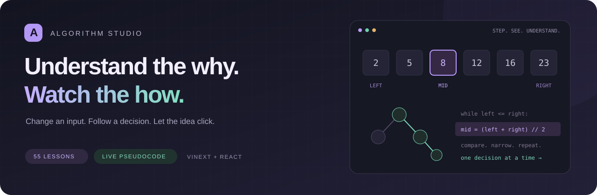
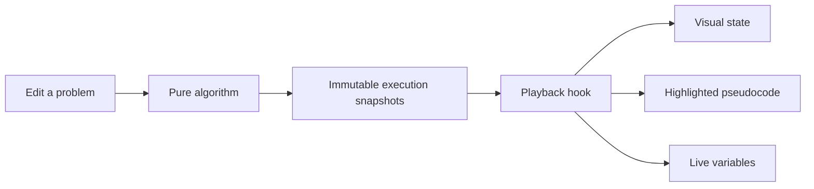

<div align="center">



**A visual workspace for algorithms, engineering concepts, and software design patterns.**

55 lessons · 26 algorithms · 6 concept labs · 23 design patterns · Dark & light themes

[Start locally](#-start-in-two-commands) · [Explore the lessons](#-the-playground) · [Study path](#-a-path-through-the-patterns) · [Architecture](#-built-to-grow)

</div>

---

## ✦ Learn the decision, not just the answer

What happens when a binary-search target is missing? Why does a greedy coin choice fail? When does a cheap flight use too many stops?

Algorithm Studio makes those questions visible. Edit the problem, step through the actual algorithm, and connect every highlighted line to the state it changes.

| Make it yours                                                          | Watch it happen                                                   | Explain it back                                                                           |
| :--------------------------------------------------------------------- | :---------------------------------------------------------------- | :---------------------------------------------------------------------------------------- |
| Change arrays, targets, capacities, terrain, edges, or flight budgets. | Follow pointers, queues, stacks, recursion, heaps, and DP tables. | Use the invariant, pattern cues, and common pitfalls to explain _why_ an algorithm works. |

Algorithm lessons include an interactive playground, an explanation, and pseudocode. Playback supports **step, back, play/pause, restart, finish, and speed control**. Algorithm execution snapshots come from the solvers themselves. Concept labs use interactive scenarios and controls; design patterns use step-by-step diagrams and pseudocode.

## 🚀 Start in two commands

**Prerequisite:** Node.js 22.12+; Node 24 recommended.

```bash
npm ci
npm run dev
```

Open **[localhost:5173](http://127.0.0.1:5173)**. No API keys, account setup, or database required.

<details>
<summary><strong>Run the production build locally</strong></summary>

Stop the development server first, then:

```bash
npm run build
npm start
```

Both server commands bind to `127.0.0.1`. Vinext builds client and server bundles into `dist/`; the output requires the production server and is not a standalone static site.

</details>

## ☁️ Deploy on every main update

The [Cloudflare deployment workflow](.github/workflows/deploy-cloudflare.yml) tests, builds, and deploys to Cloudflare Workers on every push to `main`. It also supports manual runs on `main`.

Add the repository Actions secrets **`CLOUDFLARE_API_TOKEN`**, **`CLOUDFLARE_ACCOUNT_ID`**, and **`CLOUDFLARE_DOMAIN`**. The domain must be a hostname in an active Cloudflare zone, such as `learn.example.com`. Credentials and the domain stay out of tracked configuration.

See the [deployment setup guide](docs/cloudflare-deployment.md) for token permissions, custom-domain setup, and local Workers validation.

## 🧭 The playground

The sidebar has three searchable, collapsible libraries: **Algorithms**, **Important Concepts**, and **System Design**. Expansion and scroll position survive navigation; search temporarily reveals matching groups.

### Important Concepts

| Lesson                                    | Interactive example                                                                                                                   |
| :---------------------------------------- | :------------------------------------------------------------------------------------------------------------------------------------ |
| **ACID** · `/lessons/acid`                | Transfer money, fail after a debit, inspect the committed reader view, and recover a committed transaction.                           |
| **SOLID** · `/lessons/solid`              | Five distinct object-interaction walkthroughs: responsibilities, extension, substitution, small interfaces, and dependency inversion. |
| **CAP** · `/lessons/cap`                  | Break a replication link, write a new version, and choose between rejecting an isolated read or serving a stale value.                |
| **OOP** · `/lessons/oop`                  | Encapsulation, abstraction, inheritance, and polymorphism through accounts and drawing objects.                                       |
| **DRY / KISS / YAGNI** · `/lessons/clean` | Shared domain knowledge, direct solutions, and deferring speculative features.                                                        |
| **Big O** · `/lessons/complexity`         | Change input size and compare six idealized growth models with exact counts.                                                          |

The database and network labs are in-memory teaching models. CAP consistency means linearizability; ACID consistency concerns application invariants. The examples make this distinction explicit.

### System Design · Design patterns

These are the **23 classic object-oriented design patterns**, grouped by purpose. They complement broader system design; they are not deployment architectures.

| Category       | Individual lessons                                                                                                              |
| :------------- | :------------------------------------------------------------------------------------------------------------------------------ |
| **Creational** | Factory Method, Abstract Factory, Builder, Prototype, Singleton                                                                 |
| **Structural** | Adapter, Bridge, Composite, Decorator, Facade, Flyweight, Proxy                                                                 |
| **Behavioral** | Chain of Responsibility, Command, Iterator, Mediator, Memento, Observer, State, Strategy, Template Method, Visitor, Interpreter |

Each lesson contains a concrete scenario, a diagram that highlights each call or response, pseudocode, playback, an everyday analogy, use cases, and tradeoffs. Try `/lessons/observer`, `/lessons/adapter`, or `/lessons/builder`.

### More interview essentials

| Algorithm                          | Route             | What changes as you step                                                        |
| :--------------------------------- | :---------------- | :------------------------------------------------------------------------------ |
| **Quicksort**                      | `/lessons/quick`  | Pivot, partition boundary, swaps, and height-based sorting bars.                |
| **Kadane**                         | `/lessons/kadane` | Extend the current range or start over; preserve the best sum.                  |
| **Prefix sums**                    | `/lessons/prefix` | Count earlier prefixes to find target-sum subarrays, including negative values. |
| **Longest increasing subsequence** | `/lessons/lis`    | Compare earlier values and build the length ending at each index.               |
| **House Robber**                   | `/lessons/robber` | Compare taking a house with skipping it in a DP table.                          |
| **Jump Game**                      | `/lessons/jump`   | Grow a reachable frontier or detect an unreachable gap.                         |

Quicksort uses a fixed final-element pivot for teaching: average O(n log n), worst-case O(n²). The LIS lesson uses O(n²) DP; faster variants are separate techniques.

### Arrays & searching

| Lesson                                                                    | What you see                                                                         | Search / scan cost |
| :------------------------------------------------------------------------ | :----------------------------------------------------------------------------------- | :----------------- |
| **[Binary search](lib/algorithms/array-patterns.js)** · `/lessons/binary` | Left, mid, and right pointers shrink the candidate interval.                         | O(log n)           |
| **Two pointers** · `/lessons/pointers`                                    | Two sorted-array endpoints move toward a target pair.                                | O(n)               |
| **Sliding window** · `/lessons/window`                                    | A fixed-size window adds one value, removes another, and tracks its maximum average. | O(n)               |
| **Hash-map Two Sum** · `/lessons/hashing`                                 | Complement lookups build a map of original indices.                                  | O(n) expected      |

Binary search and two pointers validate sorted input without changing its indices. Binary search returns a zero-based index; Two Sum II returns one-based positions.

### Sorting, stacks & heaps

| Lesson                                                         | What you see                                                             | Time            |
| :------------------------------------------------------------- | :----------------------------------------------------------------------- | :-------------- |
| **[Merge sort](lib/algorithms/sorting.js)** · `/lessons/merge` | Height-based bars, recursive intervals, a merge buffer, and sorted runs. | O(n log n)      |
| **Monotonic stack** · `/lessons/stack`                         | Daily Temperatures: unresolved days pop when a warmer day arrives.       | O(n)            |
| **Min-heap · Kth largest** · `/lessons/heap`                   | A bounded heap retains k values; its root gives the kth largest.         | O(n log(k + 1)) |

### Linked lists & trees

| Lesson                                                                      | What you see                                                            | Time |
| :-------------------------------------------------------------------------- | :---------------------------------------------------------------------- | :--- |
| **[Reverse linked list](lib/algorithms/structures.js)** · `/lessons/linked` | `prev`, `current`, and `following` move while each next arrow reverses. | O(n) |
| **Binary-tree inorder** · `/lessons/tree`                                   | An explicit ancestor stack produces left → node → right order.          | O(n) |

### Dynamic programming & backtracking

| Lesson                                                                   | What you see                                                          | Time                      |
| :----------------------------------------------------------------------- | :-------------------------------------------------------------------- | :------------------------ |
| **[Coin change](lib/algorithms/dynamic-patterns.js)** · `/lessons/coins` | Minimum coins for every smaller amount, then recovered denominations. | O(amount × denominations) |
| **Subsets** · `/lessons/subsets`                                         | Choose, recurse, and undo while the power set grows.                  | O(n × 2ⁿ)                 |
| **[0/1 knapsack](lib/algorithms/knapsack.js)** · `/lessons/knapsack`     | Take/skip decisions fill a table and recover the optimal pack.        | O(n × capacity)           |

### Graphs & shortest paths

| Lesson                                                                 | What you see                                                   | Time              |
| :--------------------------------------------------------------------- | :------------------------------------------------------------- | :---------------- |
| **[BFS](lib/algorithms/graphs.js)** · `/lessons/bfs`                   | A queue explores layers and finds a fewest-edge route.         | O(V + E)          |
| **DFS** · `/lessons/dfs`                                               | A stack follows branches to demonstrate reachability.          | O(V + E)          |
| **Dijkstra** · `/lessons/dijkstra`                                     | The cheapest known route expands first.                        | O((V + E) log V)  |
| **A\*** · `/lessons/astar`                                             | Cost so far and a consistent heuristic guide the search.       | O((V + E) log V)  |
| **Cheapest flights** · `/lessons/flights`                              | Previous/next cost layers enforce a maximum of K stops.        | O((K + 1)(V + E)) |
| **[Topological sort](lib/algorithms/structures.js)** · `/lessons/topo` | Prerequisite counts unlock courses; a cycle blocks completion. | O(V + E)          |

BFS, DFS, Dijkstra, and A* share editable grids and weighted networks. Add walls, paint terrain, move endpoints, change costs, and disable edges to compare their behavior on the same problem.

### Game trees & minimax

| Lesson                                                            | What you see                                                               | Time             |
| :---------------------------------------------------------------- | :------------------------------------------------------------------------- | :--------------- |
| **[Tic-tac-toe](lib/algorithms/tic-tac-toe.js)** · `/lessons/ttt` | Complete minimax search, candidate scores, optimal play, and recursion.    | O(bᵈ) worst case |
| **[Chess](lib/algorithms/chess.js)** · `/lessons/chess`           | Legal moves, depth 1–3 search, alpha–beta pruning, and best continuations. | O(bᵈ) worst case |

## ⌨️ Practice with familiar inputs

The eighteen interview lessons include a linked LeetCode problem, a worked example, editable named inputs, and the algorithm’s return value. Input arrays use bracket notation; the animation and highlighted pseudocode use the same data.

| Pattern                | Example input                                               | Return value                  |
| :--------------------- | :---------------------------------------------------------- | :---------------------------- |
| Binary search          | `nums = [-1,0,3,5,9,12], target = 9`                        | `4`                           |
| Two Sum II             | `numbers = [2,7,11,15], target = 9`                         | `[1,2]`                       |
| Maximum average window | `nums = [1,12,-5,-6,50,3], k = 4`                           | `12.75`                       |
| Merge sort             | `nums = [5,2,3,1]`                                          | `[1,2,3,5]`                   |
| Daily Temperatures     | `temperatures = [73,74,75,71,69,72,76,73]`                  | `[1,1,4,2,1,1,0,0]`           |
| Kth largest            | `nums = [3,2,1,5,6,4], k = 2`                               | `5`                           |
| Tree inorder           | `root = [1,null,2,3]`                                       | `[1,3,2]`                     |
| Course Schedule II     | `numCourses = 4, prerequisites = [[1,0],[2,0],[3,1],[3,2]]` | `[0,1,2,3]` (one valid order) |

Sorting accepts **0–100**, with up to 16 values. Bar heights share a fixed scale during each run, and a minimum visible height keeps zero and small values readable. These teaching limits are narrower than the original problems. Course pairs are **[course, prerequisite]**; graph arrows point from the prerequisite to the course.

## 🎯 A path through the patterns

1. **Read a sequence:** binary search → two pointers → sliding window → hash lookup.
2. **Keep useful state:** monotonic stack → merge sort → bounded heap.
3. **Follow structure:** linked-list reversal → tree traversal → BFS → DFS.
4. **Optimize a route:** Dijkstra → A* → topological ordering → stop-constrained flights.
5. **Reuse or explore choices:** coin change → knapsack → subsets → minimax.

For each lesson, try this loop:

> **Predict the next step → advance once → explain the invariant → change an input.**

Built-in scenarios include missing targets, duplicate pairs, all-negative windows, descending arrays, impossible amounts, and cyclic dependencies. These lessons build a foundation for interviews; practice implementing the patterns independently and adapting them to unfamiliar problems.

## 🧱 Built to grow

**Vinext App Router · React · Vite · chess.js · Node test runner · Vitest**

```text
app/                        Routes, root layout, and 404 page
components/
  layout/                   Persistent navigation, guides, and shared lesson state
  learning/                 Reusable scenario diagrams and walkthrough playback
  execution/                Pseudocode, variables, explanations, playback controls
  ui/                       Shared panels and validated numeric fields
features/
  concepts/                 ACID, CAP, growth explorer, and principle lessons
  design/                   Design-pattern lesson presentation
  interview/                Editors, arrays, structures, and trace-state panels
  minimax/                  Tic-tac-toe and chess boards
  knapsack/                 Inventory and dynamic programming table
  graphs/                   Grid, network, edge editor, and graph inspector
hooks/                      Playback timing and cleanup
lib/
  algorithms/               Pure solvers and immutable trace generators
  data/                     Lesson catalog, examples, pattern scenarios, and presets
  learning/                 Transaction, replica, and walkthrough state models
styles/                     Responsive layout and theme tokens
tests/                      Reference comparisons and React interaction tests
docs/                       README artwork and dependency notes
.github/workflows/          Automated validation
```



Lesson inputs persist across navigation in the shared React provider; reloading restores the examples. The sidebar lives in the root layout, so changing lessons preserves its scroll position and search. Its browsing position is also saved for the current browser session; the theme preference is saved in local storage. Legacy links such as `/#flights` redirect to their lesson routes.

<details>
<summary><strong>Add another interview lesson</strong></summary>

1. Implement a pure solver in `lib/algorithms/`, returning `{ code, events, result }`.
2. Record a snapshot at each meaningful step with `recorder()`. Include a code-line index, explanation, visual state, and live variables.
3. Add metadata, examples, an invariant, and an interview pitfall to `lib/data/interview-lessons.js`.
4. Register the solver in `lib/algorithms/interview.js`; extend the visual components if the algorithm needs a new representation.
5. Add an independent correctness check and an interaction test.

The route and lesson guide are driven by the catalog. Add each lesson to its category in `lib/data/navigation.js`; categories live under the three collapsible libraries.

</details>

## 🧪 Verify the behavior

```bash
npm test                 # Algorithm correctness and snapshot checks
npm run test:components  # Editing, execution controls, and timer cleanup
npm run build            # Production client, SSR, and RSC builds
npm run check            # All three checks
npm run format           # Format source and documentation
```

Algorithm and React interaction tests cover exhaustive pair checks, reference sorting, heap invariants, every valid window size, independent tree traversal, coin change against BFS, power-set comparison, cycle detection, pathfinding references, bounded-flight enumeration, adversarial tic-tac-toe play, exhaustive checks for the added algorithms, ACID rollback/recovery invariants, CAP partition behavior, all pattern diagrams, and persisted sidebar expansion.

GitHub Actions is configured to run `npm run check` on pushes and pull requests. Local test results are independent of GitHub runner availability.

## A few deliberate boundaries

- Complexity labels describe the algorithms. Storing snapshots for rewind adds memory and runtime overhead.
- Input limits keep visualizations readable; this is a learning workspace, not a large-dataset benchmark.
- The chess engine evaluates material at a limited depth. It is designed for teaching minimax.
- The tree editor accepts compact level-order arrays with `null` for missing children, such as `[1,null,2,3]`. Inorder is sorted only when the values form a BST.
- The app runs locally. This repository does not configure public deployment.
- See [dependency notes](docs/dependencies.md) for the remaining upstream build-tool advisory.

---

<div align="center">

**Less memorizing. More understanding.**

Built for the _“oh, now I get it”_ moment.

</div>
